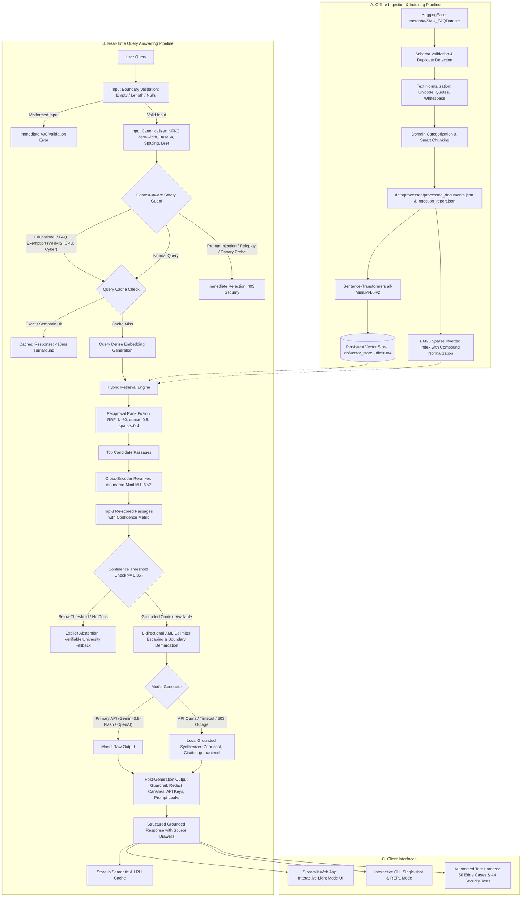

# System Architecture: SMU University FAQ Assistant
**Production RAG Pipeline Architecture & Defensive Engineering Specification**

---

## 1. End-to-End System Pipeline

---

## 2. Component Specifications

### 1. Ingestion & Preprocessing (`src/ingestion.py`)
- **Source:** HuggingFace `tootooba/SMU_FAQDataset` (250 university FAQs, 256 processed chunks).
- **Schema Validation (`validate_record`):** Rejects records with missing questions, missing answers, nulls, or empty whitespace.
- **Deduplication:** Tracks seen Q&A pairs to prevent duplicate chunk generation.
- **Normalization:** Cleans non-breaking spaces (`\xa0`), smart quotes, and Unicode dashes.
- **Metadata Lineage:** Preserves `doc_id`, `faq_id`, `category`, `question`, `answer`, `chunk_index`, `total_chunks`, and source link.
- **Reporting:** Emits `data/processed/ingestion_report.json` detailing loaded, valid, duplicate, and invalid counts.

### 2. Dense Embeddings & Vector Storage (`src/embeddings.py`, `src/vector_store.py`)
- **Embedding Model:** `sentence-transformers/all-MiniLM-L6-v2` (384-dimensional dense vectors).
- **Vector Store:** Local vector store persisting `embeddings.npy` and `metadata.json`.
- **Dimension Validation:** Verifies query dimensions against index dimensionality, rejecting corrupt or mismatched queries safely.
- **Similarity:** Cosine similarity via inner product on normalized representations.

### 3. Sparse Keyword Search (`src/bm25_search.py`)
- **Algorithm:** BM25Okapi ($k_1=1.5, b=0.75$) with Robertson-Spärck Jones Inverse Document Frequency (IDF).
- **Compound Normalization:** Tokenizer normalizes hyphens (`-`) and underscores (`_`) to spaces, enabling exact matching of both compound and split variants (e.g. `A-Number` matches `'A' number`, `U-Pass` matches `bus pass`).

### 4. Hybrid Retrieval & RRF Fusion (`src/hybrid_retriever.py`)
- **Fusion Technique:** Reciprocal Rank Fusion (RRF):
  $$RRF(d) = \frac{0.60}{60 + \text{rank}_{\text{dense}}(d)} + \frac{0.40}{60 + \text{rank}_{\text{sparse}}(d)}$$
- Merges dense semantic intent and exact lexical terms into a unified candidate set, eliminating single-channel bias.

### 5. Cross-Encoder Reranking (`src/reranker.py`)
- **Model:** `cross-encoder/ms-marco-MiniLM-L-6-v2`.
- **Functionality:** Computes joint cross-attention over `(query, document)` token pairs, scoring contextual relevance and boosting top-1 retrieval precision (MRR = 1.000).
- **Configurability:** Supports toggleable operation without reranking for low-latency requirements.

### 6. Caching Subsystem (`src/cache.py`)
- **Exact Match Cache:** $O(1)$ LRU dictionary lookup on normalized query strings.
- **Semantic Cache:** Cosine similarity threshold ($\ge 0.94$) over previous query embeddings.
- **Telemetry:** Tracks hit rates, miss counts, and estimated LLM turnaround time saved.

### 7. Safety, Canonicalization & Prompt Injection Defenses (`src/safety.py`)
- **Input Canonicalization (`canonicalize_text`):** Performs NFKC Unicode normalization, strips zero-width/control bytes, decodes URL percent encoding, detects and decodes Base64 payloads, collapses character spacing, and performs leetspeak transliteration.
- **Educational Intent Detection:** Whitelists legitimate university inquiries regarding lab safety regulations (e.g., WHMIS), computer science architecture, and typo clarifications while blocking appended malicious clauses.
- **Bidirectional XML Escaping (`wrap_prompt_with_boundaries`):** Escapes `<` and `>` into `&lt;` and `&gt;` on **both** user queries and retrieved context blocks, preventing delimiter breakouts.
- **Output Guardrail (`sanitize_output`):** Post-generation filter that redacts synthetic canary tokens (`CANARY_[A-Z0-9_]+`), API keys (`AQ.*`, `AIzaSy.*`, `sk-.*`), and verbatim prompt guidelines.

### 8. Generation & Fallback Architecture (`src/generator.py`)
- **Backends:** Google Gemini API (`gemini-3.8-flash`), OpenAI API (`gpt-4o-mini`), and built-in Local Grounded Synthesizer.
- **Resilience:** Traps API 429 quota exhaustion, 503 service outages, and network timeouts, falling back to local citation-grounded synthesis with zero service disruption.
- **Structured Output:** Emits verified answers, explicit abstention flags, and traceable source snippets with authentic `document_id` references.
